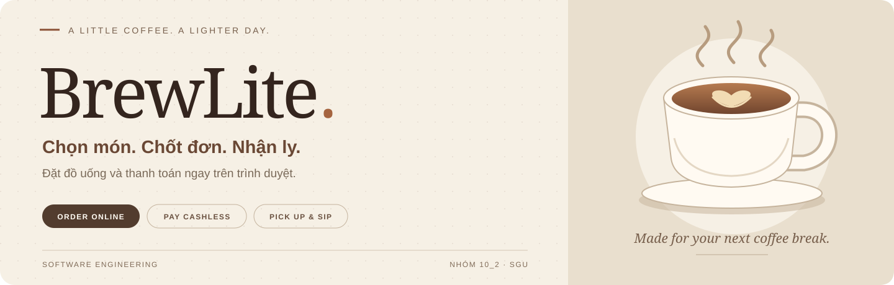
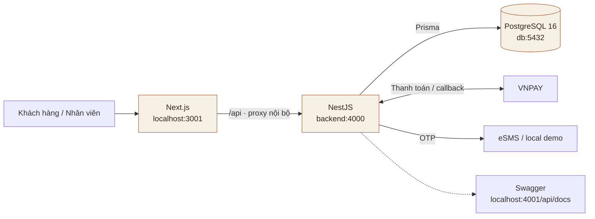

<div align="center">



# BrewLite · Cà phê trong vài chạm

**Hệ thống đặt đồ uống tại quầy và thanh toán không dùng tiền mặt.**


Đồ án môn **Công nghệ phần mềm** · **Nhóm 10_2**<br/>
Khoa Công nghệ Thông tin · Trường Đại học Sài Gòn<br/>
Giảng viên hướng dẫn: **ThS. Từ Lãng Phiêu**

[Chạy dự án](#bat-dau) · [Trải nghiệm](#trai-nghiem) · [Kiến trúc](#kien-truc) · [Kiểm thử](#kiem-thu) · [Nhóm thực hiện](#nhom)

</div>

---

Một ly cà phê bắt đầu từ sở thích của khách và kết thúc ở quầy pha chế. BrewLite
kết nối hai phía trong cùng một hệ thống: khách chọn món, tùy chỉnh và thanh toán;
nhân viên nhận đơn, chuẩn bị đồ uống và theo dõi nguyên liệu.

<a id="bat-dau"></a>

## 01 / Mở quán bằng một lệnh

### Chuẩn bị một lần

Máy cần có **Docker Desktop** đang chạy. Tải mã nguồn về máy và mở terminal tại
thư mục gốc `brewlite`.

Nếu chưa có `backend/.env`, sao chép [backend/.env.example](backend/.env.example)
thành `backend/.env` trong trình soạn thảo, rồi cập nhật:

| Biến | Cấu hình |
| --- | --- |
| `DATABASE_URL` | Giữ giá trị mẫu nếu dùng PostgreSQL mặc định của dự án. Với database đã có dữ liệu, giữ đúng tài khoản và tên database đang dùng. |
| `JWT_SECRET` | Thay `change-me` bằng chuỗi bí mật riêng. |
| `OTP_HASH_SECRET` | Dùng một chuỗi bí mật riêng khác, dài ít nhất 32 ký tự. |

Nếu đã có `.env`, giữ cấu hình hiện tại. File này chỉ lưu ở máy cá nhân.

### Khởi động

```powershell
docker compose up --build
```

Docker build ứng dụng, khởi động PostgreSQL, áp dụng migrations rồi chạy backend
và frontend theo thứ tự healthcheck. Lần đầu cần mạng để tải image, thư viện và
tài nguyên build. Không cần cài Node.js trên máy để chạy theo cách này.

| Mở ở đâu? | Địa chỉ |
| --- | --- |
| **Website** | <http://localhost:3001> |
| **Swagger API** | <http://localhost:4001/api/docs> |
| **Healthcheck** | <http://localhost:3001/api/health> |
| **PostgreSQL** | `localhost:5432` |

Healthcheck sẵn sàng sẽ trả `{"status":"ok","db":"up"}`.
Mỗi lần mở lại dự án vẫn dùng lệnh trên. Nhấn **Ctrl+C** để dừng; dữ liệu được giữ
trong volume `brewlite_pgdata`.

> **Về dữ liệu demo:** lệnh khởi động tự áp dụng migrations, chưa tự seed.
> Database mới cần được bổ sung dữ liệu mẫu trước khi dùng tài khoản và menu demo.
> Xem [hướng dẫn dữ liệu mẫu](backend/README.md#nâng-cấp-an-toàn).

<a id="trai-nghiem"></a>

## 02 / Từ thực đơn tới quầy pha chế

**Chọn món → Tùy chỉnh → Giỏ hàng → Thanh toán → Theo dõi đơn → Nhận đồ uống**

| Người dùng | Có thể làm gì? |
| --- | --- |
| **Khách hàng** | Tìm và lọc món, chọn size và topping, chỉnh giỏ hàng, dùng mã giảm giá hoặc điểm thưởng, thanh toán và xem lịch sử đơn. |
| **Barista** | Nhận đơn đã thanh toán, chuyển trạng thái pha chế, quản lý món và topping, cấu hình công thức, nhập kho và ghi nhận hao hụt nguyên liệu. |
| **Quản lý** | Cấp tài khoản Barista đã xác thực để nhân viên đăng nhập và làm việc. |

### Những phần giữ cho một đơn hàng đi đúng luồng

| Nghiệp vụ | Cách BrewLite xử lý |
| --- | --- |
| **Tài khoản và phân quyền** | Đăng ký bằng số điện thoại, xác thực OTP, đăng nhập bằng JWT; mật khẩu được băm bằng bcrypt. API kiểm tra vai trò Customer, Barista và Manager. |
| **Giá được tính tại backend** | Máy chủ kiểm tra món, size, topping, khuyến mãi và điểm sử dụng trước khi chốt số tiền của đơn. |
| **Gửi lại khi mạng chập chờn** | Tạo đơn và thanh toán dùng `Idempotency-Key` để nhận diện yêu cầu lặp; cùng key nhưng khác nội dung sẽ bị từ chối. |
| **Tồn kho theo công thức** | Kiểm tra và giữ nguyên liệu khi đặt đơn; cập nhật bằng transaction và kiểm tra `version` để xử lý cạnh tranh tồn kho. |
| **Thanh toán** | Tích hợp VNPAY, kiểm tra chữ ký callback, hỗ trợ đối soát và luồng hoàn tiền; có thanh toán mô phỏng cho môi trường local. |
| **Điểm thưởng** | Tích lũy theo giá trị thanh toán và quy đổi điểm để giảm số tiền cần trả. |

Luồng xử lý tại quầy:

`PENDING → PAID → PREPARING → READY → COMPLETED`

Hệ thống còn xử lý thanh toán thất bại, thử lại, hủy đơn và đơn quá hạn theo điều
kiện nghiệp vụ. API từ chối chuyển trạng thái không hợp lệ.

### Một vòng demo

Khi database đã có dữ liệu mẫu và cấu hình thanh toán phù hợp:

1. Mở [menu](http://localhost:3001/menu), chọn món, size và topping còn khả dụng.
2. Đăng nhập, thêm món vào giỏ, kiểm tra số lượng và áp dụng ưu đãi nếu có.
3. Tạo đơn và thanh toán. Với VNPAY, cần cấu hình sandbox hợp lệ; với mock local,
   cần bật `PAYMENT_MOCK_ENABLED=true`.
4. Mở [quầy Barista](http://localhost:3001/barista) bằng tài khoản nhân viên,
   xử lý đơn qua các bước pha chế, sẵn sàng và hoàn tất.
5. Quay lại [đơn hàng của khách](http://localhost:3001/orders) để xem trạng thái
   và chi tiết đơn.

| Tài khoản sau khi seed | Email | Mật khẩu local |
| --- | --- | --- |
| Khách hàng | `demo@brewlite.com` | `Demo@1234` |
| Barista | `barista@brewlite.com` | `Barista@123` |

Manager không được tạo mặc định. Cấu hình Manager demo và OTP local được mô tả
trong [hướng dẫn Postman](backend/postman/README.md). Đăng ký bằng OTP cần cấu hình
eSMS hoặc chế độ demo local; các khóa eSMS trong file mẫu đang để trống.

<a id="kien-truc"></a>

## 03 / Bên trong BrewLite



Trình duyệt gọi `/api` cùng origin với frontend. Next.js chuyển tiếp request đến
`http://backend:4000/api` trong mạng Docker. Cổng trong container là **3000/4000**;
cổng truy cập từ máy tính là **3001/4001**. URL quay về từ VNPAY được cấu hình
thành `http://localhost:3001/payment/vnpay-return` trong Compose.

### Công nghệ

| Thành phần | Công nghệ | Vai trò |
| --- | --- | --- |
| Frontend | Next.js 16, React 19, TypeScript | Giao diện, định tuyến và chuyển tiếp API. |
| Giao diện | Tailwind CSS 4 | Responsive và chế độ sáng/tối. |
| Trạng thái | Zustand, TanStack Query | Giỏ hàng, phiên đăng nhập và dữ liệu từ API. |
| Backend | NestJS 12, TypeScript ESM | REST API, xác thực, phân quyền và nghiệp vụ. |
| Dữ liệu | Prisma 6, PostgreSQL 16 | Truy vấn, migrations và transaction. |
| Đóng gói | Docker, Docker Compose, Node.js 24 trong image | Chạy frontend, backend và database cùng nhau. |
| Kiểm thử | Vitest, Node.js test runner, Postman | Kiểm tra nghiệp vụ, frontend và luồng API. |

### Bản đồ mã nguồn

```text
brewlite/
├── frontend/
│   ├── src/app/           # Menu, giỏ hàng, checkout, đơn hàng, Barista, Manager
│   ├── src/components/   # Các thành phần giao diện
│   ├── src/lib/          # API client và xử lý luồng phía trình duyệt
│   ├── src/store/        # Giỏ hàng, tài khoản, giao diện
│   └── Dockerfile
├── backend/
│   ├── src/auth/         # Đăng nhập, OTP và cấp tài khoản nhân viên
│   ├── src/products/     # Sản phẩm và topping
│   ├── src/orders/       # Đơn hàng, trạng thái và chống tạo trùng
│   ├── src/payments/     # Thanh toán, VNPAY và đối soát
│   ├── src/inventory/    # Nguyên liệu, công thức và biến động kho
│   ├── src/promotions/   # Mã giảm giá và quy tắc điểm thưởng
│   ├── prisma/           # Schema, migrations và dữ liệu mẫu
│   ├── postman/          # Collection, environment và báo cáo kiểm thử
│   └── Dockerfile
├── docs/                 # Báo cáo đồ án và phân công nhóm
├── scripts/              # Kiểm tra dịch vụ và menu chạy qua Compose
├── .github/workflows/    # Cấu hình CI/CD
└── docker-compose.yml
```

<a id="kiem-thu"></a>

## 04 / Kiểm thử có minh chứng

Dự án có kiểm thử cho tính giá, quyền truy cập, trạng thái đơn, yêu cầu lặp,
thanh toán, khuyến mãi và cạnh tranh nguyên liệu. Các bộ tích hợp PostgreSQL dùng
database kiểm thử và schema riêng.

| Tài liệu | Nội dung |
| --- | --- |
| [Backend tests](backend/test/README.md) | Unit, tích hợp API, transaction, cạnh tranh dữ liệu và kiểm thử trình duyệt cho cấu hình sản phẩm. |
| [Frontend tests](frontend/test/README.md) | Giỏ hàng, phiên đăng nhập, checkout, lỗi mạng và kiểm tra giao diện. |
| [Postman](backend/postman/README.md) | Collection, cách chạy thử từng luồng và bộ chạy tích hợp local. |
| [Báo cáo Postman](backend/postman/reports/latest-run.md) | Lần chạy lưu ngày 16/11/2026: collection 65 request, 91 assertions, không có assertion thất bại. OTP và ngân hàng VNPAY được mô phỏng local. |

<a id="go-loi"></a>

## 05 / Khi ly cà phê chưa tới quầy

| Hiện tượng | Kiểm tra |
| --- | --- |
| `port is already allocated` | Cổng **3001**, **4001** hoặc **5432** đang bị chiếm. Xem container trong Docker Desktop hoặc ứng dụng đang dùng cổng. |
| Backend báo `P1001` / không kết nối database | Kiểm tra log PostgreSQL và backend. Compose thay host/port thành `db:5432`, giữ tài khoản, tên database và schema trong `backend/.env`. |
| Frontend mở được nhưng API lỗi | Kiểm tra backend đã qua healthcheck; dùng địa chỉ website cổng **3001** và Swagger cổng **4001**. |
| Menu trống hoặc tài khoản demo không đăng nhập được | Kiểm tra database đã có dữ liệu mẫu. Khởi động Compose không tự seed. |
| `SMS_NOT_CONFIGURED` | Bổ sung cấu hình eSMS hoặc dùng chế độ OTP demo local theo hướng dẫn Postman. |
| Không chọn được size / thiếu nguyên liệu | Kiểm tra công thức của size, trạng thái bán và lượng nguyên liệu còn khả dụng trong kho. |

Giữ log lỗi để xác định service gặp vấn đề. Không xóa volume database để xử lý
lỗi khởi động nếu cần giữ dữ liệu.

<a id="nhom"></a>

## 06 / Những người đứng sau quầy

| Thành viên | MSSV | Phạm vi thực hiện |
| --- | --- | --- |
| **Lê Trọng Bảo Tấn** · Trưởng nhóm | `3124410316` | Kiến trúc nền tảng, giỏ hàng, tạo đơn và tính giá, xác thực, lịch sử đơn, Docker, tích hợp và review. |
| **Đỗ Chí Thanh** | `3124410320` | API và giao diện sản phẩm, menu, tùy chọn đồ uống, nguyên liệu và tồn kho. |
| **Trần Anh Trung** | `3124410380` | Giao diện checkout, thanh toán VNPAY, điểm thưởng và xử lý thử lại thanh toán. |

### Hồ sơ dự án

- [Báo cáo đồ án BrewLite — Nhóm 10_2](docs/BrewLite_Assignment1_Nhom10_2.pdf)
- [Phân công và tiến độ thực hiện](docs/BaoCao-PhanCong.pdf)
- [Chi tiết backend](backend/README.md) · [Chi tiết frontend](frontend/README.md)

Nhóm làm việc qua Pull Request, cần ít nhất một người review trước khi tích hợp.
Nhánh theo luồng `main ← develop ← feature/task-x-ten`; commit dùng các tiền tố
`feat:`, `fix:`, `docs:`, `chore:`.

---

<div align="center">

**BrewLite — Chọn món. Chốt đơn. Nhận ly.**<br/>
<sub>Đồ án Công nghệ phần mềm · Nhóm 10_2 · SGU · 2026</sub>

</div>
